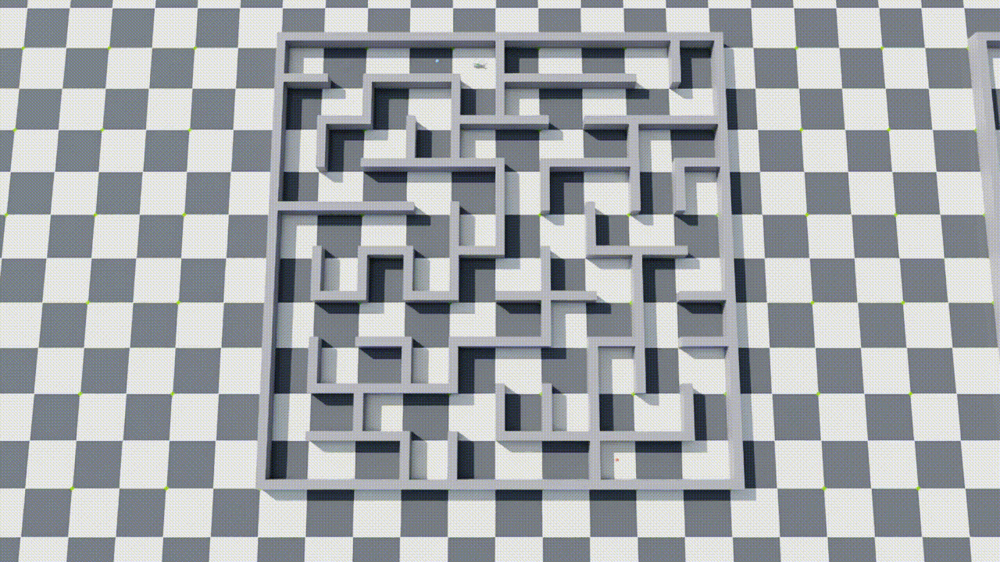

# Unitree Go2 LiDAR maze navigation in NVIDIA Isaac Lab

**360° LiDAR · hierarchical PPO · frozen velocity policy · occupancy-grid planner**

[](https://docs.omniverse.nvidia.com/isaacsim/latest/overview.html)
[](https://isaac-sim.github.io/IsaacLab)
[](https://docs.python.org/3/whatsnew/3.12.html)
[](https://github.com/leggedrobotics/rsl_rl)
[](LICENSE)



**task-go2-lidar-maze** is a [Nepher Robotics](https://github.com/nepher-ai) extension for [NVIDIA Isaac Lab](https://isaac-sim.github.io/IsaacLab) / [Isaac Sim](https://docs.omniverse.nvidia.com/isaacsim/latest/overview.html). It trains a **Unitree Go2** to navigate enclosed mazes from a **360° LiDAR** scan: a frozen velocity-tracking policy, an **LSTM** that turns one waypoint and four path points into a velocity command, and an online planner that builds an **occupancy grid** from LiDAR hits.

Use this repository when you need Isaac Lab Gym environments for Go2 **LiDAR maze navigation**, a **hierarchical frozen locomotion** stack (`Nepher-Go2-LidarMaze-LL-*`, `Nepher-Go2-LidarMaze-HL-*`, `Nepher-Go2-LidarMaze-Planner-*`), or the EnvHub benchmark `go2-maze-v0`.

Agents: start at [`llms.txt`](llms.txt) (index) or [`llms-full.txt`](llms-full.txt) (single-file context). Query-shaped answers: [`docs/`](docs/README.md).

| | |
|---|---|
| **Robot** | Unitree Go2 |
| **Simulator** | NVIDIA Isaac Sim 6.1.0 + Isaac Lab 3.0 |
| **Algorithm** | rsl_rl PPO. Low-level velocity tracker, high-level LSTM actor-critic |
| **HL stack** | Occupancy-grid planner → LSTM 10 Hz → frozen velocity policy 50 Hz → physics 200 Hz |
| **HL observation** | 199 values: 180 LiDAR ranges, one waypoint, four path points, body velocity, gravity, last action |
| **Command** | vx [-2, 3] m/s, vy [-1, 1] m/s, yaw rate [-2, 2] rad/s |
| **Deployment map** | Empty at reset. LiDAR occupancy grid. The planner does not read the maze graph |
| **Eval** | EnvHub `go2-maze-v0`, scored by eval-nav `navigation.go2` v1 |
| **License** | BSD 3-Clause |

## Who this is for

- Researchers training **quadruped navigation** on the Unitree Go2 in Isaac Lab from a **360° LiDAR** scan, not from a privileged maze map.
- Teams composing a **hierarchical frozen policy**: an LSTM that outputs a velocity command while a frozen locomotion policy writes the joints.
- Benchmarks on the EnvHub bundle **`go2-maze-v0`**: 60 enclosed mazes, one robot per tile, fixed spawn and goal.
- The Unitree G1 hurdle stack is [task-humanoid-run-jump](https://github.com/nepher-ai/task-humanoid-run-jump).

## How it runs

```
Online planner       occupancy grid → one waypoint + path points     deployment
        │
        ▼
LSTM PPO             199-D obs → vx, vy, ωz                        10 Hz
        │
        ▼
Frozen velocity      tracks that command → joint targets           50 Hz
        │
        ▼
PhysX                Unitree Go2                                  200 Hz
```

Train bottom-up: **velocity policy → export TorchScript → maze LSTM**. Training and `Nepher-Go2-LidarMaze-HL-Play-v0` replace the online planner with a privileged A* waypoint on the maze graph.

Three pieces:

- **Low-level policy.** Flat-ground velocity tracking. The command envelope is vx [-2, 3] m/s, vy [-1, 1] m/s, yaw rate [-2, 2] rad/s. Exported to TorchScript and then frozen.
- **High-level policy.** A velocity command out. The inputs are one waypoint, four points on its path (1 m to 4 m ahead), and a 360° LiDAR scan. An LSTM actor-critic, because a waypoint up to five cells away can sit behind a corner the current scan cannot see.
- **Planner.** At deployment the map starts empty. LiDAR hits fill an occupancy grid. A distance field on that grid reaches the goal: inflated walls block, cells the scan has not reached cost more than cleared cells, and the field does not use the maze lattice (cell origin, pitch, or size). The policy is given one waypoint on the cleared part of that route, at most 5 m and about 1 m short of the first sharp corner (a point on the corner made it sprint into the wall), pulled back further when that point sits against a mapped wall, plus the next few metres of the path. A mapped dead end stays a dead end. A first step behind the robot has to beat the corridor ahead by 4 m.

Training and `Nepher-Go2-LidarMaze-HL-Play-v0` take waypoints from a privileged A* on the maze graph. The online planner never reads that graph and never reads the `path:` line. On every reset, each environment draws a random start cell and a different random goal cell, and draws again when A* finds no path between them. The robot is placed on the start centre plus ±0.4 m, with a yaw in [-π, π). The goal is that cell's centre.

The maze USD is spawned once, at `/World/Maze`. Every environment shares it (`env_spacing = 0`, robot-robot collisions filtered). The LiDAR sits on top of the head, in the base frame, and ray-casts the maze, the ground plane at `/World/ground/terrain`, and that robot's own visual meshes. Robots do not see each other. A beam stops on a wall, the floor, or the body.

## Gym environments

| Id | What it is |
| --- | --- |
| `Nepher-Go2-LidarMaze-LL-v0` | Train the velocity policy |
| `Nepher-Go2-LidarMaze-LL-Play-v0` | Play it, at the final command ranges |
| `Nepher-Go2-LidarMaze-HL-v0` | Train the maze policy on privileged waypoints |
| `Nepher-Go2-LidarMaze-HL-Play-v0` | Play that task with one environment. Loads the latest high-level checkpoint |
| `Nepher-Go2-LidarMaze-Planner-Play-v0` | Same policy with the online planner. New reachable start and goal per robot each episode |
| `Nepher-Go2-LidarMaze-Planner-Envhub-Play-v0` | Same planner on the `go2-maze-v0` benchmark. One robot per maze tile, fixed spawn and goal. Loads `best_policy/best_policy.pt` |

`./isaaclab.sh train` and `play` discover these through the `isaaclab.tasks` entry point. The package does not import `isaaclab_tasks`. `scripts/environments/list_envs.py` only prints ids that contain `Isaac`, so these six do not appear in that table.

## Install

Clone [task-go2-lidar-maze](https://github.com/nepher-ai/task-go2-lidar-maze). Isaac Sim has to run with its bundled Python, so every command goes through `./isaaclab.sh` from the Isaac Lab root.

Inside an Isaac Lab tree this package is `source/task-go2-lidar-maze/source/go2_lidar_maze`. A standalone clone of this repository uses `source/go2_lidar_maze` instead.

```bash
./isaaclab.sh -p -m pip install -e source/task-go2-lidar-maze/source/go2_lidar_maze
```

TensorBoard logs are under this project, not the Isaac Lab `logs` directory. From the Isaac Lab root:

```bash
./isaaclab.sh -p -m tensorboard.main --logdir source/task-go2-lidar-maze/logs --port 6006
```

## Train

Isaac Lab 3 does not have a `--headless` flag. `--viz none` runs without a window. Leave it off for the high-level task and the window can draw every robot: a line for each LiDAR beam, a sphere where that beam hits the maze, the ground, or the robot, a green sphere at that episode's spawn, and a red sphere at its waypoint.

Each of those drawings has its own switch, and each defaults to off. Append any of `env.vis_lidar_beams=true`, `env.vis_lidar_hits=true`, and `env.vis_start_goal=true` to the play command. `Nepher-Go2-LidarMaze-Planner-Envhub-Play-v0` turns the start and goal drawing on by itself when a window is open. That drawing is a green sphere on each tile's maze start, a red sphere on that tile's maze goal, and a blue sphere on the current target waypoint. The points sampled along the path are not drawn. `--viz none` still skips it.

```bash
./isaaclab.sh train --task Nepher-Go2-LidarMaze-LL-v0 --viz none
./isaaclab.sh -p source/task-go2-lidar-maze/scripts/export_ll_policy.py --checkpoint PATH/model.pt
./isaaclab.sh train --task Nepher-Go2-LidarMaze-HL-v0 --viz none
./isaaclab.sh play --task Nepher-Go2-LidarMaze-HL-Play-v0 --viz none
./isaaclab.sh play --task Nepher-Go2-LidarMaze-Planner-Play-v0 --viz none
./isaaclab.sh play --task Nepher-Go2-LidarMaze-Planner-Envhub-Play-v0 --video --num_envs 60
```

## Query pages

Each file answers one search. Prefer these over the whole README when the question is specific.

| Query | Page |
|---|---|
| Isaac Lab Unitree Go2 LiDAR maze navigation | [docs/isaac-lab-unitree-go2-lidar-maze.md](docs/isaac-lab-unitree-go2-lidar-maze.md) |
| Frozen Go2 velocity tracking | [docs/isaac-lab-go2-velocity-tracking.md](docs/isaac-lab-go2-velocity-tracking.md) |
| Hierarchical frozen policy stack | [docs/hierarchical-frozen-go2-policy.md](docs/hierarchical-frozen-go2-policy.md) |
| LiDAR occupancy grid, no prior maze map | [docs/go2-lidar-occupancy-grid.md](docs/go2-lidar-occupancy-grid.md) |
| Gym IDs `Nepher-Go2-LidarMaze-*` | [docs/nepher-go2-lidar-maze-gym-ids.md](docs/nepher-go2-lidar-maze-gym-ids.md) |
| EnvHub `go2-maze-v0` | [docs/envhub-go2-maze-v0.md](docs/envhub-go2-maze-v0.md) |
| Go2 LiDAR maze vs G1 hurdle jump | [docs/go2-lidar-maze-vs-g1-hurdle.md](docs/go2-lidar-maze-vs-g1-hurdle.md) |

Index: [docs/README.md](docs/README.md).

## FAQ

**What robot and simulator does this target?**
Unitree Go2 in NVIDIA Isaac Sim 6.1.0 with Isaac Lab 3.0 (Python 3.12, rsl_rl PPO). The physics step is 0.005 s (200 Hz). The frozen velocity policy runs at 50 Hz. The LSTM runs at 10 Hz.

**What does the high-level policy output?**
A velocity command in vx [-2, 3] m/s, vy [-1, 1] m/s, yaw rate [-2, 2] rad/s. Zero means standing still. A frozen locomotion policy tracks that command and writes the joint targets.

**Does deployment need the maze map?**
The occupancy grid starts empty. LiDAR hits fill it, and a distance field on that grid chooses the waypoint. Training and `Nepher-Go2-LidarMaze-HL-Play-v0` use a privileged A* path on the maze graph. The online planner never reads that graph.

**Which Gym ID should I start with?**
Velocity tracking: `Nepher-Go2-LidarMaze-LL-v0`, then `scripts/export_ll_policy.py`. Maze policy: `Nepher-Go2-LidarMaze-HL-v0`. Online planner: `Nepher-Go2-LidarMaze-Planner-Play-v0`. Fixed benchmark: `Nepher-Go2-LidarMaze-Planner-Envhub-Play-v0` on `go2-maze-v0`.

**How is go2-maze-v0 scored?**
eval-nav scores `Nepher-Go2-LidarMaze-Planner-Envhub-Play-v0` with `navigation.go2` v1. The bundle is 60 enclosed mazes, one robot on each tile, spawn and goal taken from that maze.

**Where do the policies load from?**
`export_ll_policy.py` writes `best_policy/ll_policy/ll_policy.pt`. The high-level task raises `FileNotFoundError` until that file exists. `Nepher-Go2-LidarMaze-HL-Play-v0` and `Nepher-Go2-LidarMaze-Planner-Play-v0` load the latest `model_*.pt` under `logs/go2_lidar_maze_hl` unless you pass `--checkpoint`. `Nepher-Go2-LidarMaze-Planner-Envhub-Play-v0` loads `best_policy/best_policy.pt`.

## License

Copyright (c) 2026, [Nepher Robotics](https://github.com/nepher-ai). All rights reserved.
Distributed under the [BSD 3-Clause License](LICENSE).

**Keywords:** Unitree Go2, quadruped, LiDAR, maze navigation, occupancy grid, reinforcement learning, PPO, LSTM, hierarchical policy, frozen policy, NVIDIA Isaac Lab, Isaac Sim, rsl_rl, EnvHub, go2-maze-v0, Nepher.
